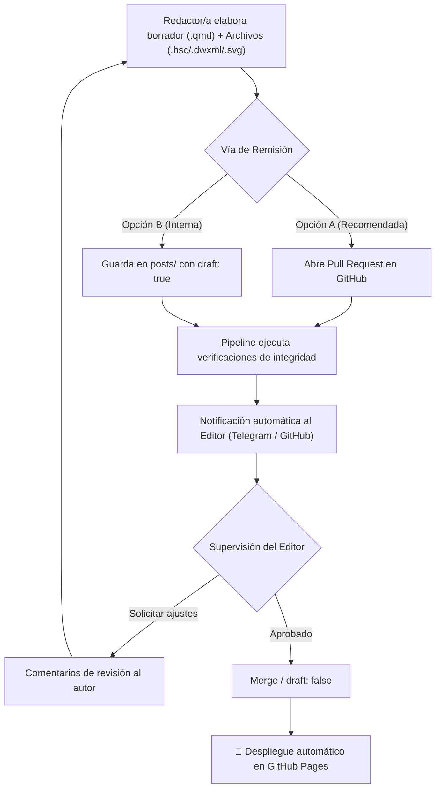

<!-- Distintivo Institucional SOPQ -->
<div class="post-header-brand">
  <div class="brand-visual">
    
    
  </div>
  <div class="brand-text">
    <div class="brand-institution">Universidad de Vigo &middot; Escuela de Ingeniería Industrial</div>
    <div class="brand-lab">SOPQ // Simulación y Optimización de Procesos Químicos</div>
  </div>
  <div class="brand-status">
    <span class="status-indicator"></span> Normativa Editorial v1.0
  </div>
</div>

::: {.callout-note appearance="simple"}
## Bienvenido/a al equipo editorial de SOPQ // ProcessSim
Este blog es el repositorio abierto de ingeniería química y termodinámica computacional de la **Escuela de Ingeniería Industrial (Universidad de Vigo)**. Toda aportación técnica es revisada por el editor antes de su publicación definitiva para asegurar rigor físico, reproducibilidad numérica y coherencia estética.
:::

---

## Flujo de Publicación y Supervisión Editorial

Para garantizar la calidad de los casos de simulación, **ningún post se publica directamente en producción sin la revisión previa del editor**. Existen dos mecanismos principales para proponer un nuevo artículo:



### Opción A: Propuesta mediante Pull Request en GitHub (Recomendada)
1. Haz un **fork** del repositorio oficial [`github.com/anxosanchez/sopqblog`](https://github.com/anxosanchez/sopqblog).
2. Crea una nueva rama con nombre descriptivo (ej: `post/cstr-bioetanol` o `post/hysys-amoniaco`).
3. Redacta el artículo tomando como base la plantilla canónica [`posts/_template_post.qmd`](https://github.com/anxosanchez/sopqblog/blob/main/posts/_template_post.qmd).
4. Adjunta los archivos de simulación en `assets/simulations/` y los diagramas gráficos en `assets/images/`.
5. Abre una **Pull Request** dirigida a la rama `main`.
6. Nuestro sistema automatizado notificará de inmediato al editor por **Telegram** y ejecutará la auditoría técnica de taxonomía.

### Opción B: Publicación en modo borrador oculto (`draft: true`)
Si cuentas con permisos de acceso directo al repositorio, puedes subir tu archivo `.qmd` dentro de la carpeta `posts/` añadiendo la siguiente propiedad en el encabezado YAML:

```yaml
---
title: "Simulación de..."
draft: true   # <-- MANTIENE EL POST OCULTO
---
```

> **¿Qué hace `draft: true`?** Quarto compila el artículo de forma privada pero **no lo incluye en los listados públicos de portada, ni en el buscador, ni en el sitemap ni en las fuentes RSS**. El editor podrá revisar el resultado renderizado, validar los balances y, una vez aprobado, retirar la etiqueta `draft: true` para su pase a producción pública.

---

## Autoría: Cómo Indicar Autor o Múltiples Autores

Cada artículo debe reconocer con precisión la autoría intelectual del caso de simulación. Quarto permite definir tanto autores individuales como equipos multidisciplinares con afiliación institucional:

```yaml
---
title: "Simulación de una Torre de Debutinizadora con Peng-Robinson"
subtitle: "Modelado Riguroso y Optimización de la Tasa de Reflujo"
author:
  - name: "Laura Gómez Fernández"
    affiliation: "Escuela de Ingeniería Industrial, Universidad de Vigo"
    email: "laura.gomez@uvigo.gal"
    role: "Modelado y Simulación en HYSYS"
  - name: "Anxo Sánchez"
    affiliation: "Escuela de Ingeniería Industrial, Universidad de Vigo"
    email: "anxo.sanchez@uvigo.gal"
    role: "Supervisión Termodinámica y Revisión Editorial"
date: "2026-11-10"
categories: ["Aspen HYSYS", "Separación", "Caso HSC", "Vídeo Titorial"]
---
```

---

## Descarga de Plantillas y Contacto

- 📄 **[Plantilla Canónica de Post (.qmd)](https://github.com/anxosanchez/sopqblog/blob/main/posts/_template_post.qmd)**
- 📁 **[Repositorio GitHub Oficial (sopqblog)](https://github.com/anxosanchez/sopqblog)**

Para dudas sobre el modelado o propuesta de temas, contacta directamente con el editor:  
📧 **Anxo Sánchez** &middot; `anxo.sanchez@uvigo.gal` &middot; Escuela de Ingeniería Industrial, Universidad de Vigo.
